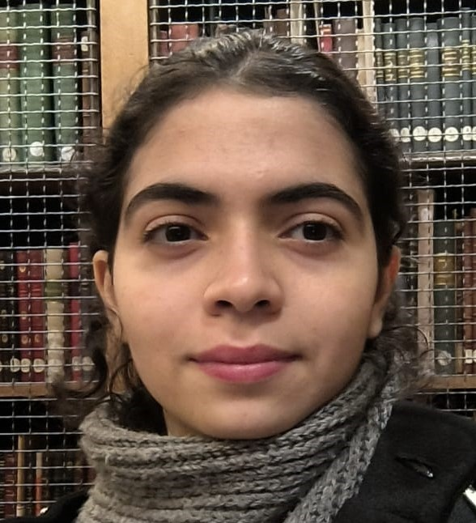
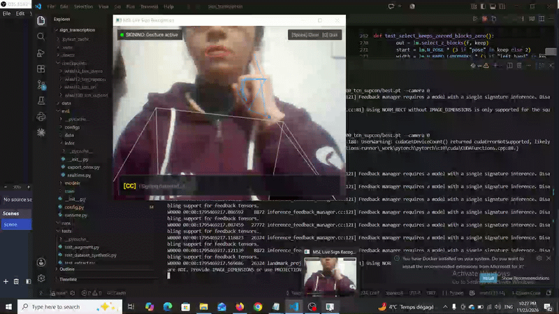

# Hi, I'm Fatima Alharake
**AI Engineer & Researcher**
I hold a Bachelor’s in Computer Science and a Master’s in AI. My work bridges theoretical foundations with applied engineering, spanning computer vision, generative modeling, and agentic LLM systems.

[Email](mailto:fatima_alharake@outlook.com) • [LinkedIn](https://www.linkedin.com/in/fatima-al-harake-954a812ba/) • [GitHub](https://github.com/Fatima-alharake)
 

## Featured Projects

### ASL Sign Transcription (In Progress)
> Real-time camera interface that transcribes sign language into live closed captions.

* **Highlights:** Extracts normalized 3D body, hand, and facial keypoints with **MediaPipe Holistic** and frame-to-frame velocity kinematics; classifies temporal gesture sequences in **PyTorch** using a **Temporal Convolutional Network (TCN)** with motion-gated live captioning in **OpenCV**.
* **Tech:** `Computer Vision` `PyTorch` `MediaPipe` `TCN` `OpenCV`

  
<b>🎬 Live Demo</b>

   

  <!-- Replace with your actual demo GIF or video -->
  

    
  

---

### FlowSR: Generative Super-Resolution for 2D Fluid Dynamics (In Progress)
> Reconstructing high-resolution fluid flow fields from coarse simulations using generative models.

* **Highlights:** Compares a deterministic U-Net baseline against a probabilistic Conditional VAE (cVAE) to capture turbulent vortices and estimate predictive confidence.
* **Tech:** `PyTorch` `cVAE` `U-Net` `HDF5` `NumPy` `SciPy`
